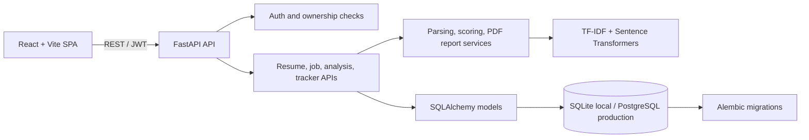

# AI-Powered ATS Resume Analyzer & Job Match Tracker

A full-stack application for comparing an uploaded resume with a manually pasted job description, explaining the match, tracking applications, and downloading a report. Scores are estimates for decision support; they are not the internal score of any employer's ATS.

> **Implementation status:** Core application flows are implemented and covered by tests. OCR for scanned PDFs, token revocation, and live cloud deployment are not implemented or verified. Do not treat this as a deployed production service.

## Features

- Email/password registration and login with Argon2 password hashing and short-lived JWTs.
- Protected, user-scoped API records; resume/job/analysis/application lookups are authorized to the owner.
- PDF and DOCX uploads with size, extension, media type, package, and document checks. Original uploaded files are processed in memory and discarded; extracted text and parsed fields are saved.
- Direct resume analysis: select or drop a PDF/DOCX, paste the job description, and submit both inputs together without first saving either separately. The extracted resume, job description, and analysis are persisted for the authenticated user.
- Heuristic resume extraction for contact details, skills, education, experience, projects, and certifications. Extracted contact fields are advisory and should be reviewed.
- Saved job descriptions with extracted title, required/preferred skills, experience/education requirements, responsibilities, and project context.
- Canonical skill aliases, exact/partial/missing skill results, contextual explanations, TF-IDF vectorization/cosine similarity, and Sentence Transformer semantic similarity.
- Explainable weighted compatibility estimate. Defaults use configured raw weights of 35/25/20/40/10 for required skills, keywords, experience, education, and projects. Because these total 130, available components are normalized for the final score. Unavailable evidence is excluded, not automatically scored as zero.
- Grounded, rule-based resume suggestions; advice never tells users to claim an unearned skill or fabricate an achievement.
- Saved analyses, score history, dashboard metrics, searchable jobs, application status/notes, and downloadable PDF reports.
- Responsive React UI with dashboard chart, resume library, job descriptions, analysis detail, history, tracker, and profile pages.

## Architecture



The backend is organized under `backend/app/` into API routes, core configuration/security, SQLAlchemy models, document/job services, and matching/report services. PostgreSQL uses psycopg 3; SQLite is used for local development and tests. The React app calls the FastAPI API using Axios and sends a bearer token held in browser `sessionStorage`. On the Resume Analyzer page, users can upload or drop a PDF/DOCX and paste a job description (minimum 30 characters); the original file is discarded after parsing.

## Stack

- **Frontend:** React, TypeScript, Vite, Tailwind CSS, React Router, Axios, Recharts, Lucide React, Vitest, Testing Library
- **Backend:** Python, FastAPI, Pydantic, SQLAlchemy, Alembic, PyJWT, pwdlib/Argon2
- **Analysis:** PyMuPDF, python-docx, scikit-learn TF-IDF/cosine similarity, Sentence Transformers, NumPy
- **Persistence/reporting:** SQLite or PostgreSQL, ReportLab

## Local development

### Requirements

- Python 3.13 (see `backend/.python-version`)
- Node.js 22 and npm
- Network access on the first semantic analysis to download the configured Sentence Transformer model

### Backend

Run these commands in PowerShell:

```powershell
Set-Location backend
python -m venv .venv
.\.venv\Scripts\Activate.ps1
python -m pip install -r requirements.txt
Copy-Item .env.example .env
python -m alembic upgrade head
python -m uvicorn app.main:app --reload
```

The API is at `http://127.0.0.1:8000`; health/readiness endpoints are `/api/health` and `/api/health/ready`. OpenAPI documentation is at `/docs`.

### Frontend

In a second terminal:

```powershell
Set-Location frontend
Copy-Item .env.example .env.local
npm install
npm run dev
```

Vite proxies `/api` to `http://127.0.0.1:8000`. The dashboard has an empty state until you register and analyze a resume against a job description. Existing resume and job libraries remain available for management and tracking.

### Semantic model

The configured model defaults to `sentence-transformers/all-MiniLM-L6-v2`. It loads lazily on the first analysis and uses CPU inference. A failed model download/load returns an explicit `503`; the application does not silently substitute a fabricated semantic score. Set `SEMANTIC_MODEL_NAME` only to a compatible Sentence Transformer model.

## API overview

All application endpoints are under `/api`; endpoints other than health require `Authorization: Bearer <access_token>`.

| Area | Endpoints |
| --- | --- |
| Auth/profile | `POST /auth/register`, `POST /auth/login`, `POST /auth/logout`, `GET/PATCH /auth/me` |
| Resumes | `POST/GET /resumes`, `GET/DELETE /resumes/{id}` |
| Jobs | `POST/GET /jobs`, `GET/PATCH/DELETE /jobs/{id}`; `GET /jobs?search=...` |
| Analysis | `POST /analyses/upload` (multipart `file` + `job_description`), `POST/GET /analyses`, `GET /analyses/{id}`, `GET /analyses/{id}/report` |
| Tracker | `GET/POST /applications`, `PATCH/DELETE /applications/{id}` |
| Dashboard | `GET /dashboard` |
| Health | `GET /health`, `GET /health/ready` |

Interactive request/response schemas are available at `/docs`.

## Configuration and privacy

Copy `backend/.env.example` to `backend/.env` for local work. Never commit `.env` files, API keys, access tokens, local database files, or uploaded documents. `.gitignore` excludes local environment/database/upload/build artifacts. `frontend/.env.example` contains only the public API base URL; do not put secrets in `VITE_*` variables.

Production configuration rejects the development secret, non-PostgreSQL database URLs, PostgreSQL URLs without required SSL, wildcard CORS, and non-HTTPS production origins. Set `CORS_ORIGINS` to exact comma-separated frontend origins. Original resume files are not retained, but extracted resume text and analysis data are stored until the user deletes the resume; resume deletion cascades associated analyses.

Scanning/OCR is not supported. Scanned PDFs with no selectable text return a validation error. Do not log resume text, passwords, database URLs, or tokens.

## Database migrations

The Alembic history starts from the existing initial schema and adds parsed fields plus matched/missing skill tables. Run migrations after configuring `DATABASE_URL`:

```powershell
Set-Location backend
python -m alembic upgrade head
```

The Render Blueprint runs this command during its build. No live Supabase database was available for validation; database operations were tested against isolated SQLite.

## Testing

### Backend

```powershell
Set-Location backend
python -m pytest -q
```

Tests create synthetic in-memory PDF/DOCX fixtures and parse their actual document text; they exercise direct-upload analysis, auth/ownership/CRUD/tracking/report endpoints, and the real Sentence Transformer integration. This does not substitute for testing with a user's own resume.

### Frontend

```powershell
Set-Location frontend
npm run test:run
npm run build
```

GitHub Actions runs Alembic migrations and backend tests, then frontend tests and a production build on pushes and pull requests. The integration test downloads the model from Hugging Face when it is not already cached.

## Deployment preparation (not deployed)

The repository includes `render.yaml` for the FastAPI service, `frontend/vercel.json` for the SPA, and a GitHub Actions workflow. No provider resources are created by these files. Before deployment, configure Supabase PostgreSQL with an SSL-enabled connection string, Render `DATABASE_URL` and `CORS_ORIGINS`, and Vercel `VITE_API_BASE_URL` as the deployed API base ending in `/api`. Keep `SECRET_KEY` in Render's environment and use Render's generated value.

Do not claim a deployment is working until `/api/health/ready` confirms database access and the deployed Vercel site successfully calls the Render API. Product features should also be smoke-tested against the live environment before release.

## Current limitations

- Resume parsing is heuristic; users should review extracted information.
- Scanned-document OCR and account deletion/token revocation are not provided.
- Analysis recommendations are rule-based rather than generated by a hosted LLM.
- The live Vercel/Render/Supabase deployment has not been run or tested.
